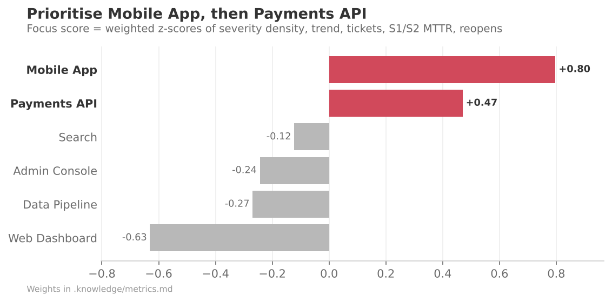
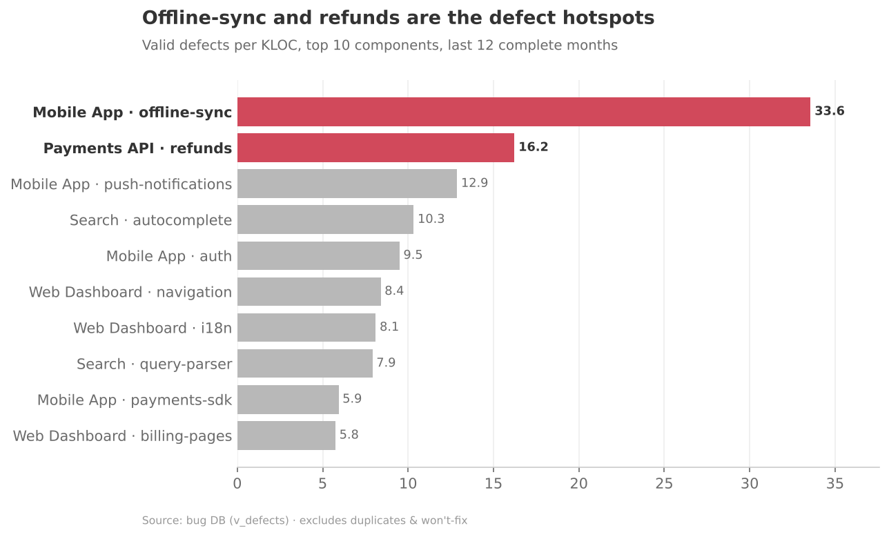
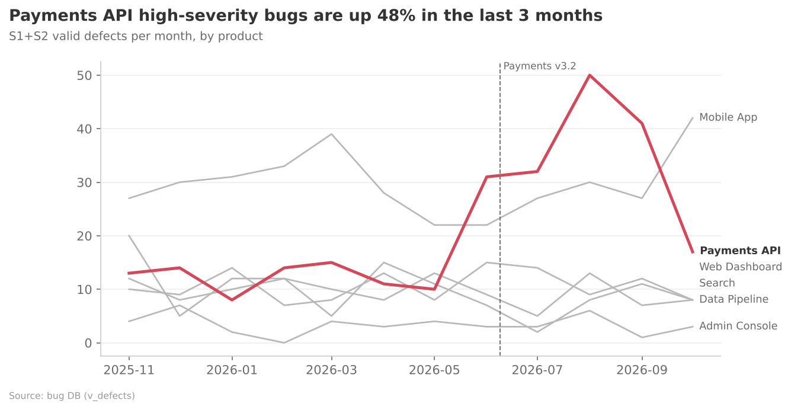

# Engineering focus report — November 21, 2026

Window: last 12 complete months (latest data 2026-11-20; partial month excluded). Population: valid defects (duplicates / won't-fix excluded). Reconciliation: product totals sum to 3,499 (OK).

## Bottom line

1. **Mobile App** has the highest focus score (+0.80): high-severity bugs +39% in the last 3 months vs the prior 3, 928 linked customer tickets.
2. **Payments API** is next (+0.47): 1.87 high-sev bugs per KLOC, reopen rate 9%.
3. Process fixes: **Search** reopens 35% of fixes (fix verification); **Admin Console** takes a median 26 days to fix S1/S2 bugs with a team of 3 (Internal Tools).

## Scorecard

| product | defects | high-sev | high-sev / KLOC | high-sev trend (3m) | tickets | S1/S2 median days | reopen | defects / eng | focus |
|---|---|---|---|---|---|---|---|---|---|
| Mobile App | 840 | 358 | 4.21 | +39% | 928 | 6.4 | 8% | 76 | **+0.80** |
| Payments API | 531 | 256 | 1.87 | +48% | 2,184 | 6.2 | 9% | 59 | **+0.47** |
| Search | 508 | 127 | 1.57 | -22% | 478 | 8.3 | 35% | 73 | **-0.12** |
| Admin Console | 105 | 40 | 1.05 | +0% | 107 | 25.7 | 5% | 35 | **-0.24** |
| Data Pipeline | 301 | 109 | 0.89 | +35% | 272 | 8.4 | 10% | 38 | **-0.27** |
| Web Dashboard | 1,214 | 122 | 0.60 | +4% | 701 | 5.6 | 6% | 87 | **-0.63** |

## Hotspot components

| product | component | KLOC | defects | high-sev | defects / KLOC |
|---|---|---|---|---|---|
| Mobile App | offline-sync | 9 | 302 | 161 | 33.6 |
| Payments API | refunds | 14 | 227 | 140 | 16.2 |
| Mobile App | push-notifications | 8 | 103 | 41 | 12.9 |
| Search | autocomplete | 9 | 93 | 29 | 10.3 |
| Mobile App | auth | 12 | 114 | 41 | 9.5 |
| Web Dashboard | navigation | 25 | 210 | 15 | 8.4 |
| Web Dashboard | i18n | 18 | 146 | 15 | 8.1 |
| Search | query-parser | 12 | 95 | 22 | 7.9 |

## What's rising

Components with ≥20 high-sev bugs in the last 3 months and ≥30% growth:

| product | component | prior 3m | recent 3m | change |
|---|---|---|---|---|
| Mobile App | offline-sync | 25 | 49 | +96% |
| Payments API | refunds | 53 | 69 | +30% |

## What looks bad but isn't

**Web Dashboard** has the most bugs in raw count (1,214), but only 10% are high severity and its high-sev density is 0.60/KLOC. Its volume reflects size, not a quality problem.

## Caveats

- KLOC is a current snapshot; densities over long windows are approximate.
- Per-MAU rates are not used for ranking because internal tools have tiny MAU.
- `found_in_release_id` is the latest release at creation time, not a verified root cause.
- Untriaged bugs (no component) in window: 203 (5.8%), excluded from component rankings only.

## Appendix — queries run

- `6b5f4e08aaa6` focus: volume by product (6 rows)
- `32c14f11e624` focus: per-MAU rate (6 rows)
- `faa94007c957` focus: product KLOC (6 rows)
- `37fc3f87b4b6` focus: high-sev trend by product (6 rows)
- `9d70962f3e58` focus: high-sev trend by component (31 rows)
- `736baadd2a66` focus: component density (26 rows)
- `29edc8eedab6` focus: flow raw (aggregated in pandas) (3390 rows)
- `bc355c882009` focus: open backlog (6 rows)
- `7ef092ca7ccd` focus: team capacity (6 rows)
- `ccde44e9ecdb` focus: monthly high-sev (72 rows)
- `2245ceb5fb8a` focus: v3.2 date (1 rows)
